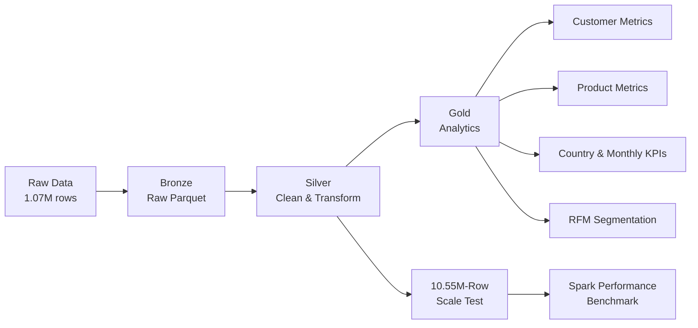

# Large-Scale E-Commerce Analytics Pipeline

An end-to-end **PySpark data engineering and analytics pipeline** that processes **1.07M retail transactions** through a Bronze–Silver–Gold architecture and evaluates Spark performance on a controlled **10.55M-row scale-test workload**.

**Tech:** PySpark • Spark SQL • Python • Parquet • Pandas • Window Functions • Git

---

## Architecture



---

## What I Built

The pipeline processes the **UCI Online Retail II** dataset containing **1,067,371 transactions** across two years of retail activity.

### Bronze
- Ingests and combines the source data
- Loads data into Spark
- Stores raw records as Parquet

### Silver
- Standardizes schemas and data types
- Removes exact duplicates
- Detects returns and cancellations
- Flags missing customer IDs
- Calculates transaction revenue
- Engineers temporal features
- Writes year-partitioned Parquet

### Gold
Creates reusable analytical datasets for:

- Customer performance
- Product performance
- Country performance
- Monthly business KPIs
- RFM customer segmentation

---

## Pipeline Results

| Metric | Result |
|---|---:|
| Raw transactions | **1,067,371** |
| Duplicates removed | **12,133** |
| Silver records | **1,055,238** |
| Valid sales records | **1,029,609** |
| Orders | **40,077** |
| Customers | **5,878** |
| Units sold | **11.39M** |
| Valid-sale revenue | **$20.91M** |

---

## RFM Customer Segmentation

Customer behavior is modeled using **Recency, Frequency, and Monetary value**.

Spark aggregations and `ntile()` window functions generate RFM scores and customer segments.

| Segment | Customers | Avg. Customer Value |
|---|---:|---:|
| Champions | 1,878 | $7,203.94 |
| Loyal Customers | 309 | $603.86 |
| Potential Loyalists | 751 | $785.05 |
| At Risk | 751 | $2,810.89 |
| Hibernating | 2,189 | $579.87 |

---

## Spark Performance Benchmark

To evaluate Spark behavior at a larger scale, the Silver dataset was replicated into a controlled **10,552,380-row workload**.

> The original dataset contains 1.07M records. The 10.55M-row workload is used only for performance testing.

| Benchmark | Runtime |
|---|---:|
| Single uncached aggregation | **3.57 s** |
| Single cached aggregation | **4.42 s** |
| 5 uncached aggregations | **4.10 s** |
| 5 cached aggregations | **3.99 s** |
| Cache materialization | **12.22 s** |

### Finding

Caching provided only a **1.03× query-time improvement** for repeated aggregations, while cache materialization introduced significant overhead.

For this workload, recomputing directly from Parquet was more efficient end-to-end than caching.

This demonstrates an important Spark principle: **performance optimizations should be benchmarked rather than assumed to improve execution.**

---

## Repository Structure

```text
spark-ecommerce-analytics-pipeline/
│
├── src/
│   ├── ingest.py        # Bronze ingestion
│   ├── clean.py         # Silver transformations
│   ├── analytics.py     # Gold analytics
│   ├── rfm.py           # Customer segmentation
│   ├── benchmark.py     # 10.55M-row performance test
│   └── pipeline.py      # Pipeline orchestration
│
├── data/
│   ├── raw/
│   ├── bronze/
│   ├── silver/
│   └── gold/
│
├── README.md
├── requirements.txt
└── .gitignore
```

---

## Run Locally

Install dependencies:

```bash
python -m venv .venv
source .venv/bin/activate
pip install -r requirements.txt
```

Download the **UCI Online Retail II** dataset and place the workbook at:

```text
data/raw/online_retail_II.xlsx
```

Run the pipeline stages:

```bash
python src/ingest.py
python src/clean.py
python src/analytics.py
python src/rfm.py
```

Run the performance benchmark:

```bash
python src/benchmark.py
```

---

## Skills Demonstrated

**PySpark • Spark SQL • ETL • Medallion Architecture • Parquet • Data Quality • Partitioning • Aggregations • Window Functions • RFM Segmentation • Caching • Performance Benchmarking**

---

## Author

**Precious Ejikeme**  
Data Science • Machine Learning • Data Engineering • AI